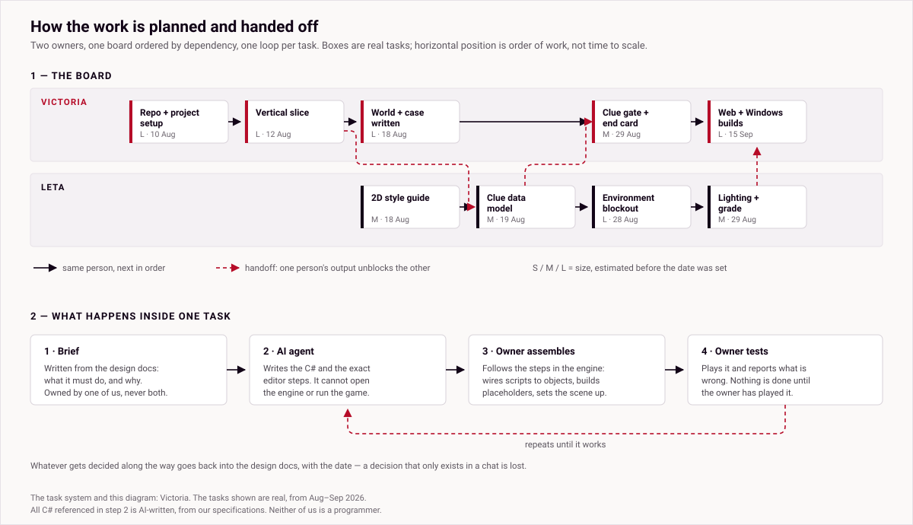
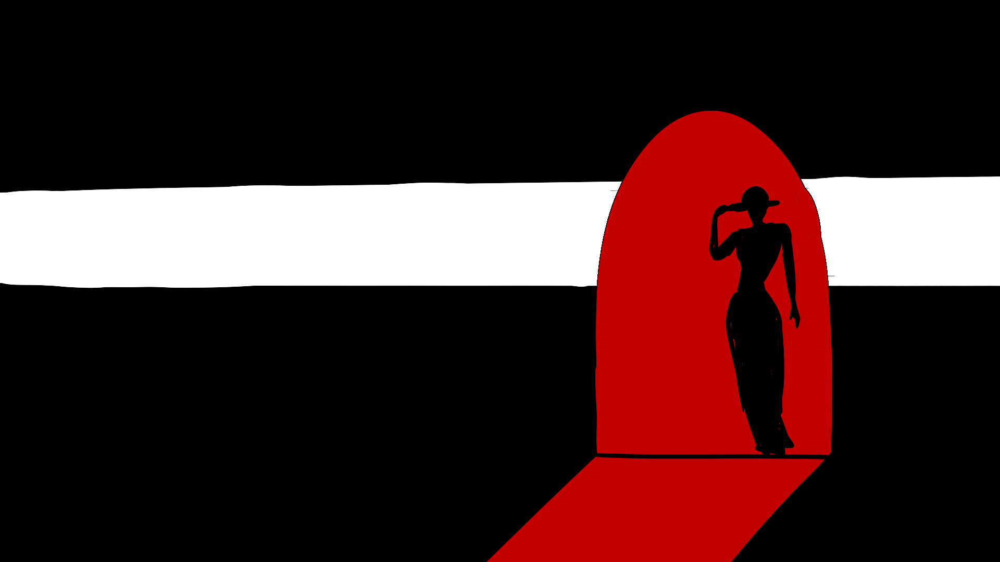

# FLAIR — public progress showcase

A **public progress log** for FLAIR, a game made by two people: **Victoria** and
**Leta**. The game itself is built in a private repository; this one exists so
that anyone interested can follow the work without the project being published
before it is allowed to be.

**What is here:** our design and production work — how the project is planned,
how two people divide and sequence it, what has been built, and who built it.
**What is not here:** the game's code, its assets, its story material, or any
third-party files. None of that is ours to publish, and some of it is not ours
at all.

*How the work is planned and handed off — the task system **Victoria** designed,
drawn from the real board with real tasks and real dependencies.
[WORKFLOW.md](WORKFLOW.md) is the written version.*

---

## The project

FLAIR is a neo-noir detective game. You investigate in 3D, and following a true
lead opens a hand-drawn 2D "vision" that reconstructs a piece of what happened.
The investigation runs on a clue system: examine the right things, in the right
order, and the case opens up — go wrong and it costs you.

It is an unofficial, **non-commercial adaptation of a contemporary novel**. We
are not naming the book, its author, or anything from it here, because we have
asked for permission and have not yet had an answer.

We build it on our own initiative, in our own time. It is **not** a university or
coursework project. Its purpose is a test: **can two people who are not
programmers get to a working game at all?**

So far, in prototype form, yes. You can walk a city block, investigate three
clues, watch a vision play, and reach an end card — in a browser or on Windows,
with touch controls on a phone.

## The team

Both of us co-lead the project, and the design is written together. The areas
below are owned, not shared, so each of us can decide inside her own without a
meeting.

### Victoria

- **Concept and case design**, with Leta: how a novel becomes a game, what counts
  as a clue, how a case is structured and solved, the world and its map, and the
  design documentation that holds it together.
- **Workflow and task planning** — mapped what each of us is better at, then built
  the task system in [WORKFLOW.md](WORKFLOW.md) and the diagram in
  [progress/workflow.svg](progress/workflow.svg).
- **Direction** — scope, priorities, what gets built next and what gets cut.
- **Assembly in Unity**, following guided steps: wiring scripts onto objects,
  building placeholder objects and scenes, basic scene setup.
- **Builds and release** — the browser and Windows builds, and getting them to
  testers.

### Leta

- **Concept and case design**, with Victoria.
- **Environment blockout** — the district the prototype takes place in.
- **Lighting and colour grade** — the noir look of the prototype is hers.
- **The clue data model** — the structure that lets clues be authored as data
  rather than written into code.
- **The clue inventory** — what the player collects and can look back at.
- **The 2D vision style guide** and its test frames, which gate every vision
  either of us draws — below.

### The 2D style, so far

The visions are hand-drawn in three colours only: black `#120417`, white
`#ffffff`, blood-red `#b60c28`. **Leta** drew these to settle how the red is
allowed to behave before anyone draws a finished vision.

|  |  |  |
|---|---|---|
| **Object hint** — red fills the highlighted object itself. | **Person hint** — the figure stays a flat silhouette; red marks the space around her. | **Gradient test** — whether shading can add depth without breaking the flat look. |

## How it's built

Unity 6 (URP), C#, with Git LFS for binaries. Two things about it should be
stated plainly rather than left to be assumed:

- **All of the C# is AI-written**, from our direction. Neither of us is a
  programmer. We decide what the game should do, run it, and say what is wrong
  with the result; an AI agent writes the code and the editor steps. We are both
  learning to read it back.
- **The art is at concept stage.** Design documents, references, style targets
  and blockout geometry. There are no modelled characters, no textures and no
  finished hand-drawn visions yet. Anything in the prototype that looks like a
  character or a finished vision is a third-party placeholder, to be replaced
  with our own work.

## Status

| | |
|---|---|
| **Playable prototype** | Private build, shared on request. Not published |
| **Code** | AI-written throughout, directed by us |
| **Art** | Concept stage. Blockout and style tests exist; nothing final |
| **Rights** | Permission from the author is **pending**. Non-commercial; nothing is distributed until it is granted |
| **Third-party placeholders** | A stock character with stock animations, and stock footage standing in for a drawn vision. Both to be replaced |

## In this repository

| File | What it is |
|---|---|
| [WORKFLOW.md](WORKFLOW.md) | How two people split, sequence and hand off the work |
| [progress/](progress/) | The work itself, each item labelled with who made it |
| [devlog.md](devlog.md) | Dated progress notes, from the first commit to now |

## Why there is so little here

A fuller showcase would be dishonest in two directions at once: it would publish
a novel's world before its author has agreed to anything, and it would show work
as ours that an AI wrote or that is a placeholder standing in for art we have not
made yet.

So this repository is deliberately thin, and it says who did what. Active
development continues privately. The project stays private and non-commercial
until the rights question is settled and the third-party placeholders are
replaced with our own work.
